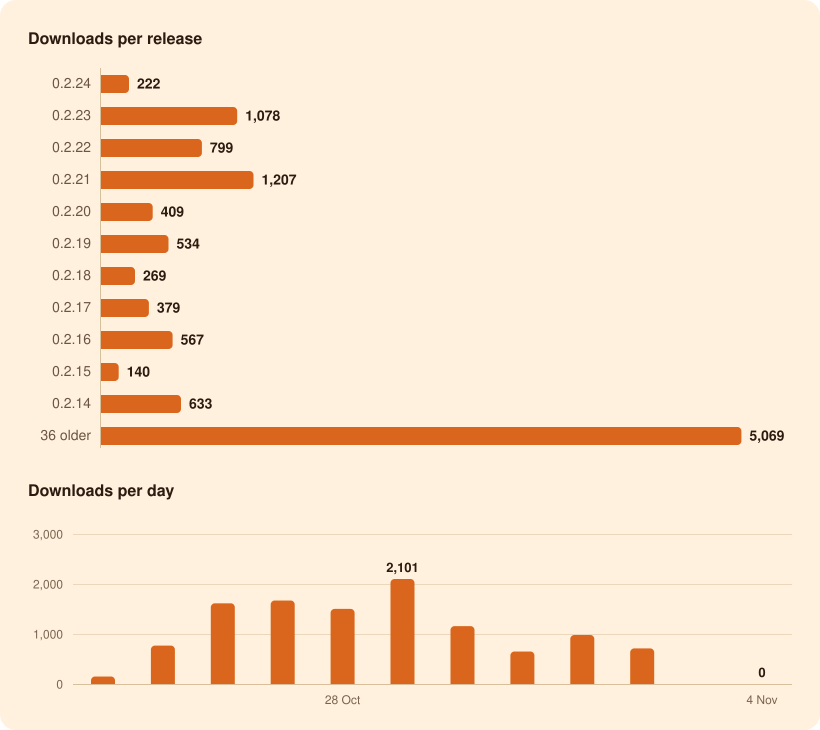

<h1 align="center">11,306 downloads</h1>

of Oyenza Studio for Windows, from GitHub since 24 Oct 2026 Last 7 days: <b>1,693</b> · <b>0</b> stars on GitHub

## Per release

| Release | Published | Download button | Versioned installer | Portable zip | Other files | Total |
| --- | --- | --: | --: | --: | --: | --: |
| [0.2.24](https://github.com/glatinone/oyenza-studio/releases/tag/v0.2.24) | — | 6 | 180 | 1 | 35 | 222 |
| [0.2.23](https://github.com/glatinone/oyenza-studio/releases/tag/v0.2.23) | — | 90 | 870 | 17 | 101 | 1,078 |
| [0.2.22](https://github.com/glatinone/oyenza-studio/releases/tag/v0.2.22) | — | 85 | 611 | 15 | 88 | 799 |
| [0.2.21](https://github.com/glatinone/oyenza-studio/releases/tag/v0.2.21) | — | 229 | 843 | 8 | 127 | 1,207 |
| [0.2.20](https://github.com/glatinone/oyenza-studio/releases/tag/v0.2.20) | — | 32 | 333 | 4 | 40 | 409 |
| [0.2.19](https://github.com/glatinone/oyenza-studio/releases/tag/v0.2.19) | — | 44 | 422 | 6 | 62 | 534 |
| [0.2.18](https://github.com/glatinone/oyenza-studio/releases/tag/v0.2.18) | — | 17 | 208 | 3 | 41 | 269 |
| [0.2.17](https://github.com/glatinone/oyenza-studio/releases/tag/v0.2.17) | — | 43 | 281 | 6 | 49 | 379 |
| [0.2.16](https://github.com/glatinone/oyenza-studio/releases/tag/v0.2.16) | — | 40 | 459 | 3 | 65 | 567 |
| [0.2.15](https://github.com/glatinone/oyenza-studio/releases/tag/v0.2.15) | — | 4 | 120 | 4 | 12 | 140 |
| [0.2.14](https://github.com/glatinone/oyenza-studio/releases/tag/v0.2.14) | — | 104 | 460 | 4 | 65 | 633 |
| [0.2.13](https://github.com/glatinone/oyenza-studio/releases/tag/v0.2.13) | — | 301 | 694 | 9 | 121 | 1,125 |
| [0.2.12](https://github.com/glatinone/oyenza-studio/releases/tag/v0.2.12) | — | 9 | 14 | 3 | 1 | 27 |
| [0.2.11](https://github.com/glatinone/oyenza-studio/releases/tag/v0.2.11) | — | 467 | 404 | 7 | 117 | 995 |
| [0.2.10](https://github.com/glatinone/oyenza-studio/releases/tag/v0.2.10) | — | 33 | 49 | 3 | 14 | 99 |
| [0.2.9](https://github.com/glatinone/oyenza-studio/releases/tag/v0.2.9) | — | 34 | 20 | 5 | 6 | 65 |
| [0.2.8](https://github.com/glatinone/oyenza-studio/releases/tag/v0.2.8) | — | 284 | 84 | 14 | 71 | 453 |
| [0.2.7](https://github.com/glatinone/oyenza-studio/releases/tag/v0.2.7) | — | 42 | 14 | 3 | 9 | 68 |
| [0.2.6](https://github.com/glatinone/oyenza-studio/releases/tag/v0.2.6) | — | 744 | 31 | 18 | 141 | 934 |
| [0.2.5](https://github.com/glatinone/oyenza-studio/releases/tag/v0.2.5) | — | 19 | 2 | 5 | 3 | 29 |
| [0.2.4](https://github.com/glatinone/oyenza-studio/releases/tag/v0.2.4) | — | 141 | 9 | 9 | 22 | 181 |
| [0.2.3](https://github.com/glatinone/oyenza-studio/releases/tag/v0.2.3) | — | 56 | 21 | 4 | 19 | 100 |
| [0.2.2](https://github.com/glatinone/oyenza-studio/releases/tag/v0.2.2) | — | 82 | 7 | 5 | 13 | 107 |
| [0.2.1](https://github.com/glatinone/oyenza-studio/releases/tag/v0.2.1) | — | 9 | 0 | 3 | 4 | 16 |
| [0.2.0](https://github.com/glatinone/oyenza-studio/releases/tag/v0.2.0) | — | 44 | 7 | 5 | 10 | 66 |
| [0.1.21](https://github.com/glatinone/oyenza-studio/releases/tag/v0.1.21) | — | 8 | 3 | 3 | 3 | 17 |
| [0.1.20](https://github.com/glatinone/oyenza-studio/releases/tag/v0.1.20) | — | 18 | 4 | 4 | 5 | 31 |
| [0.1.19](https://github.com/glatinone/oyenza-studio/releases/tag/v0.1.19) | — | 4 | 2 | 2 | 3 | 11 |
| [0.1.18](https://github.com/glatinone/oyenza-studio/releases/tag/v0.1.18) | — | 4 | 3 | 3 | 1 | 11 |
| [0.1.17](https://github.com/glatinone/oyenza-studio/releases/tag/v0.1.17) | — | 94 | 233 | 49 | 35 | 411 |
| [0.1.16](https://github.com/glatinone/oyenza-studio/releases/tag/v0.1.16) | — | 2 | 2 | 2 | 2 | 8 |
| [0.1.15](https://github.com/glatinone/oyenza-studio/releases/tag/v0.1.15) | — | 3 | 1 | 2 | 2 | 8 |
| [0.1.14](https://github.com/glatinone/oyenza-studio/releases/tag/v0.1.14) | — | 14 | 5 | 6 | — | 25 |
| [0.1.13](https://github.com/glatinone/oyenza-studio/releases/tag/v0.1.13) | — | 7 | 2 | 2 | — | 11 |
| [0.1.12](https://github.com/glatinone/oyenza-studio/releases/tag/v0.1.12) | — | 12 | 3 | 3 | — | 18 |
| [0.1.11](https://github.com/glatinone/oyenza-studio/releases/tag/v0.1.11) | — | 2 | 2 | 5 | — | 9 |
| [0.1.10](https://github.com/glatinone/oyenza-studio/releases/tag/v0.1.10) | — | 1 | 2 | 2 | — | 5 |
| [0.1.9](https://github.com/glatinone/oyenza-studio/releases/tag/v0.1.9) | — | 4 | 6 | 5 | — | 15 |
| [0.1.8](https://github.com/glatinone/oyenza-studio/releases/tag/v0.1.8) | — | 3 | 1 | 5 | — | 9 |
| [0.1.7](https://github.com/glatinone/oyenza-studio/releases/tag/v0.1.7) | — | 3 | 1 | 2 | — | 6 |
| [0.1.6](https://github.com/glatinone/oyenza-studio/releases/tag/v0.1.6) | — | 5 | 2 | 4 | — | 11 |
| [0.1.5](https://github.com/glatinone/oyenza-studio/releases/tag/v0.1.5) | — | 7 | 3 | 3 | — | 13 |
| [0.1.4](https://github.com/glatinone/oyenza-studio/releases/tag/v0.1.4) | — | 1 | 3 | 2 | — | 6 |
| [0.1.3](https://github.com/glatinone/oyenza-studio/releases/tag/v0.1.3) | — | 3 | 2 | 2 | — | 7 |
| [0.1.2](https://github.com/glatinone/oyenza-studio/releases/tag/v0.1.2) | — | 1 | 4 | 2 | — | 7 |
| [0.1.1](https://github.com/glatinone/oyenza-studio/releases/tag/v0.1.1) | — | — | 158 | 2 | — | 160 |
| [0.1.0](https://github.com/glatinone/oyenza-studio/releases/tag/v0.1.0) | — | — | 2 | 3 | — | 5 |
| **All releases** | | **3,155** | **6,587** | **277** | **1,287** | **11,306** |

## Per day

| Day | Downloads |
| --- | --: |
| Today | 0 |
| 6 Nov 2026 | 0 |
| 5 Nov 2026 | 0 |
| 4 Nov 2026 | 0 |
| 3 Nov 2026 | 0 |
| 2 Nov 2026 | 713 |
| 1 Nov 2026 | 980 |
| 31 Oct 2026 | 650 |
| 30 Oct 2026 | 1,158 |
| 29 Oct 2026 | 2,101 |
| 28 Oct 2026 | 1,502 |
| 27 Oct 2026 | 1,671 |
| 26 Oct 2026 | 1,614 |
| 25 Oct 2026 | 767 |
| 24 Oct 2026 | 150 |

## On GitHub

0 stars · 0 forks · 0 watching

How we count

- GitHub counts every download of a release file. The Download button on the [website](https://studio.oyenza.com/) and in the README always fetches `Oyenza-Studio-Setup.exe` from the newest release; the versioned installer and the portable zip are on each release's page.
- Our CI downloaded release files while it tests each push, and GitHub counts those too: 605 so far, left out of every number here ([ci-downloads.csv](data/ci-downloads.csv) lists each one). GitHub's own counters add up to 11,531.
- GitHub updates its counters every few minutes, so for a while a counter may not show a CI download that is already taken off. Each file's number keeps its highest reading, so numbers only go up.
- Still in the numbers: our own check of each new release (one download through the Download button) and any bots. GitHub can't tell those apart.
- Oyenza Studio itself sends nothing: no accounts, no tracking. These are GitHub's download counters, read every hour.
- GitHub keeps no dates for downloads, so everything before the first reading counts on 24 Oct 2026.
- Page views and clones need a `METRICS_TOKEN` repository secret: a fine-grained token for this repository with Administration: Read-only. GitHub keeps them for 14 days only.

Updated 7 Nov 2026, 01:14 UTC by [Download stats](https://github.com/glatinone/oyenza-studio/actions/workflows/metrics.yml), every hour · Data: [downloads](data/downloads.csv), [CI downloads](data/ci-downloads.csv), [stars](data/repo.csv), [summary.json](summary.json)
